# Parcours à l'œil du site, 13/11/2026

Parcours fait sans toucher au code, sur l'accord de Timothée du 13/11/2026 (« oui fait ça »), recentré par le pilote
le même jour sur **les setlists et les chants**, et sur ce qui est **peu pratique ou incohérent**, pas seulement ce qui
se voit mal. Session simulée (`tests/helpers/fakeSession.ts`), noms fictifs, `next dev` local, captures Playwright à
`deviceScaleFactor: 1`. Premier tri par l'agent `regard`, chaque constat retenu ouvert et jugé ici.

**Version 2 (complète)** : setlists et chants sur les cinq dispositions, interface chinoise, thème sombre, quatre tâches
réelles avec leurs gestes, puis planning, harmonie et Moi en survol. La version 1 (ordinateur et téléphone) a été
poussée plus tôt le même jour ; ses constats sont repris ici, confirmés sur tablette.

Déjà relevé par Timothée, donc absent d'ici : 简谱 sur une colonne en écran large, zigzag et habillages dépareillés de la
vue partitions, ligne « 4 → 4maj7 · F → Fmaj7 », pas d'idées d'harmonie sur la 简谱, menu Setlist du mode louange,
vignette vide d'un chant sans scan, son du bouton Écouter.

Dispositions : **tel** (412 px), **tabP** (tablette portrait 810 px), **tabL** (tablette paysage 1 080 px), **ordi**
(1 280 px), **1440**.

## Les cinq choses à changer en premier

1. **Les réglages du mode louange débordent de l'écran et couvrent la partition** (Options, Je joue) : pendant le culte,
   on règle à tâtons un panneau dont le bas est coupé, sur la moitié de la musique.
2. **Un même réglage est rangé à trois endroits, chaque fois autrement** : disposition, couleur des accords, ordre des
   sections, Lettres / Chiffres sont dans le menu ⋯ de la page chant, dans « Affichage » de la setlist, et coupés en
   deux menus (Je joue et Options) dans le mode louange.
3. **La tonalité n'a pas la même place ni la même forme sur les trois écrans** : barre « Ton A − + » plus pastille sur
   la page chant, petite lettre seule sur la setlist, lettre en sous-titre (« Samuel Olivier · A ») au mode louange.
4. **Le choriste voit des cadres vides** pour l'intro et l'interlude au mode louange : des boîtes titrées sans rien
   dedans, qui prennent la place des paroles.
5. **La choriste qui ouvre un chant chinois tombe sur le scan 简谱, sans pinyin**, alors que le bouton 拼 est allumé :
   il faut deviner qu'il faut passer sur « Paroles ». Au téléphone, la barre du chant coupe en plus la tonalité (« T… A »).

## Constats

Classés par gêne, celle qui touche le jeu pendant le culte d'abord. « Spec » dit si c'est voulu.

### Gêne forte (pendant le culte)

**1. Mode louange, menu Options : panneau trop long, coupé en bas, posé sur la partition.** ordi, 1440, tabL, tabP,
tel. Le panneau couvre la moitié droite de la musique ; « Couleur des accords », puis Thème, Métronome et Couleur des
icônes sont sous le bord sans signe qu'il défile ; « Partition 简谱 » et « Annotations » se touchent, « Demi-page » se
coupe en deux lignes ; un paragraphe d'aide de cinq lignes est au milieu des boutons.
Spec : le contenu est voulu (`docs/spec-entree-musiciens.md` l. 101 en dresse la liste), la hauteur et le recouvrement
non. 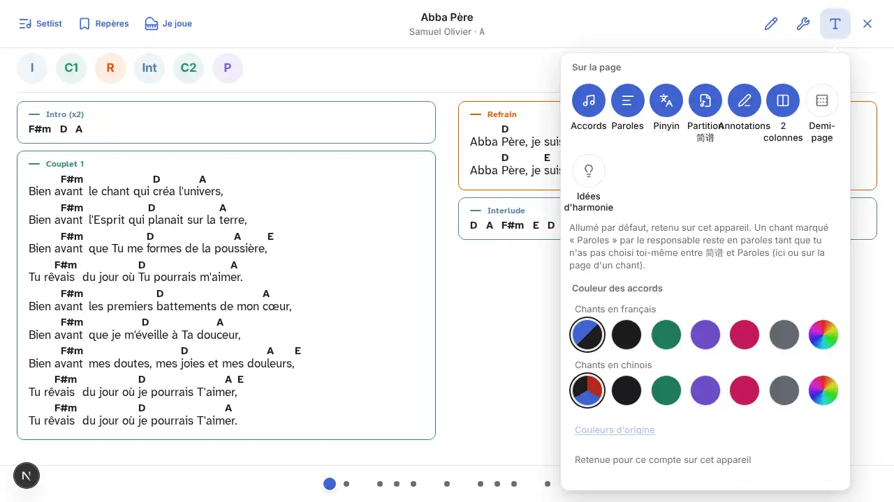
Corrigé le 13/11 (minimum demandé) : Options et Je joue tiennent dans l'écran (déjà vrai : popover borné à la hauteur
disponible, feuille du bas à 85 %) et, tant qu'il reste du contenu dessous, une flèche ronde « Suite » (44 px) se pose
sur le bas du menu ; un toucher descend d'un écran de menu, elle s'en va en bas de la liste. Le contenu des menus et le
recouvrement de la partition restent à la planche des réglages (constats 2 et 3). Test : `tests/louange-menus.spec.ts`,
« constat 1 » (commit « constat 1 »).

**2. Mode louange, menu Je joue : la « Disposition » est coupée.** tabL, ordi, tel. Les vignettes de disposition
sortent par le bas ; le menu mêle « ce que je joue » (rôle), l'ordre des sections et la disposition de la page.
Spec : l'ordre des sections ici est voulu (`docs/spec-jianpu-integration.md` L2, « même réglage que le menu Affichage
de la setlist ») ; la coupe non. 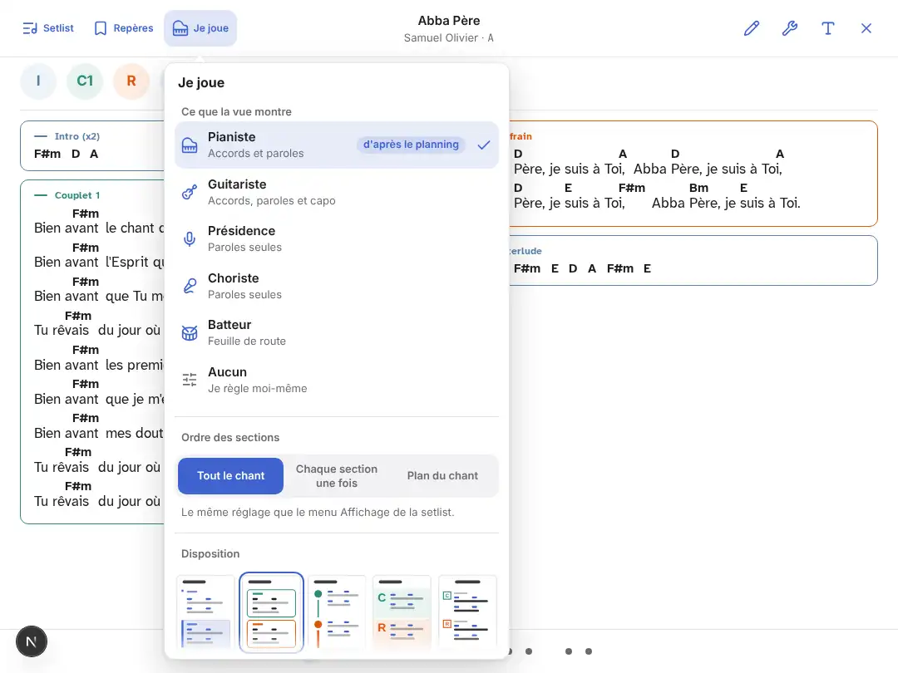

**3. Mode louange, choriste : intro et interlude en cadres vides.** Toutes dispositions. Le rôle Choriste (paroles
seules) garde les sections sans paroles comme des boîtes titrées vides, de la hauteur d'une ligne.
Spec : non prévu (`docs/spec-mode-louange-forscore-2.md` replie une rangée d'accords vide, rien sur une section vide).
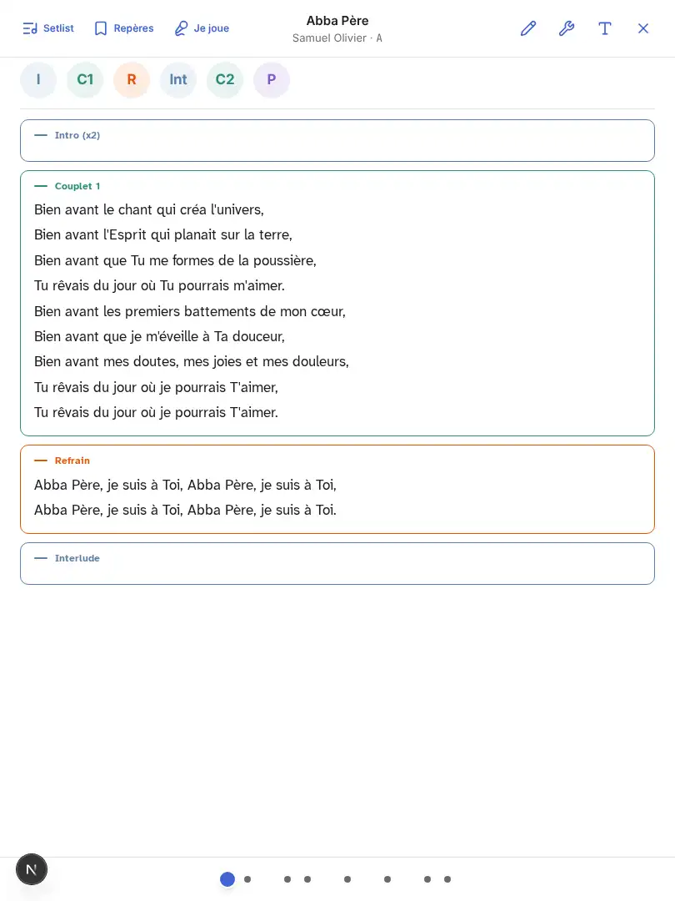
Corrigé le 13/11 : accords non montrés (Choriste, Présidence, « Accords » éteint), une section sans paroles, note,
nuance ni modulation n'est plus affichée au mode louange (ni rendue ni comptée en hauteur) ; le pianiste la garde.
Décision déléguée écrite dans `docs/spec-entree-musiciens.md`. Test : `tests/louange-role-regle.spec.ts`, « pas de cadre
vide » (72c01574).

**4. Mode louange : changer de chant sans savoir où on va.** Toutes dispositions. Le bas de l'écran n'a que des points
(treize pour cinq chants à l'ordinateur), groupés par chant mais sans numéro ni titre ; aucune capture ne montre le titre du
chant suivant avant d'y arriver. Spec : les points sont voulus (curseur de page) ; l'absence de repère du
chant suivant n'est écrite nulle part.

**4 bis. Choriste, chant chinois : le scan s'ouvre, le pinyin est introuvable.** Toutes dispositions. Tâche « une
choriste cherche un chant chinois et lit le pinyin » : onglet Chants, 中文, recherche, toucher le chant (quatre gestes) ;
la page s'ouvre sur le scan 简谱, qui n'a pas de pinyin, avec le bouton 拼 allumé et le segment « 简谱 · Paroles » sous
les pastilles, loin de la barre. Il faut un cinquième geste, sur « Paroles », que rien n'indique.
Spec : le segment et son réglage retenu sont voulus (`docs/spec-jianpu-integration.md` D5) ; le scan d'office pour une
choriste n'est voulu nulle part (`docs/spec-jianpu-deux-volets.md`, en cours, le veut pour les musiciens).
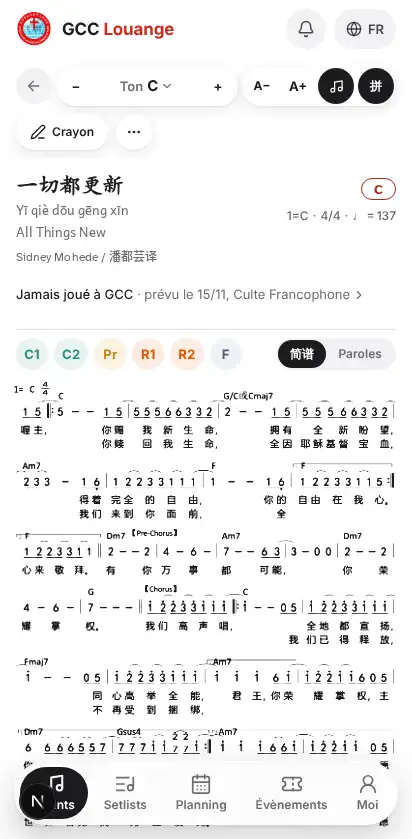

### Gêne moyenne (préparer, retrouver, régler)

**5. Page chant au téléphone : barre d'outils sur deux lignes, tonalité tronquée.** tel. « T… A » en français, « ㅣC »
en chinois ; Vidéo, Crayon et ⋯ passent à la ligne, la page commence sous 130 px de commandes.
Spec : aucune ne prévoit une tonalité tronquée.
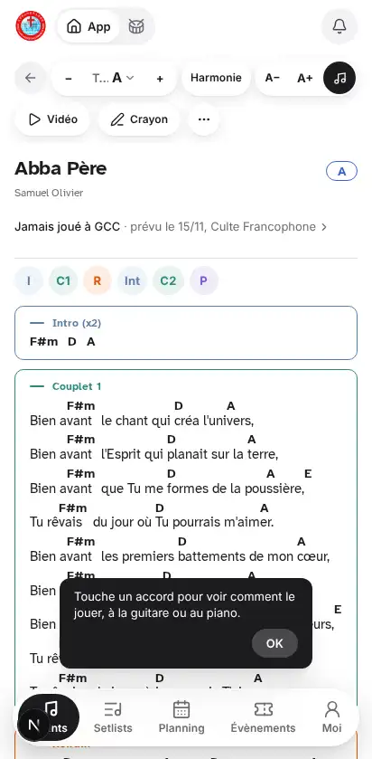 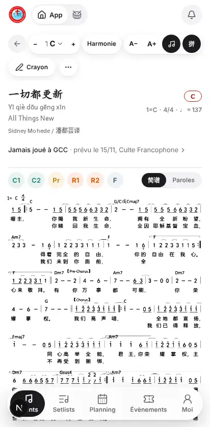
Corrigé le 13/11 : le mot « Ton » / « 调 » passe entier ou disparaît, la lettre reste toujours entière (« A ⌄ » au
téléphone, « Ton A » dès qu'il y a la place) ; les deux rangées du téléphone sont voulues (`docs/spec-barre-chant.md`,
Q5) et restent. Test : `tests/key-selector.spec.ts`, « jamais de mot rogné » (1cd595c2).

**6. La tonalité, trois écrans, trois formes.** Page chant : « Ton A − + » dans la barre **et** une pastille « A » à
droite du titre (en chinois s'y ajoute « 1=C » sous le titre : trois fois la même information). Setlist : une lettre
« A » bleue sans cadre, seule, en haut à droite. Mode louange : « · A » à la fin du sous-titre, en petit. On ne voit pas
où transposer dans la setlist ni au mode louange. Comparer `chant-fr-ordi`, `setlist-ordi`, `louange-options-ordi`.
Spec : chaque place est décrite séparément ; aucune spec ne les met en regard.
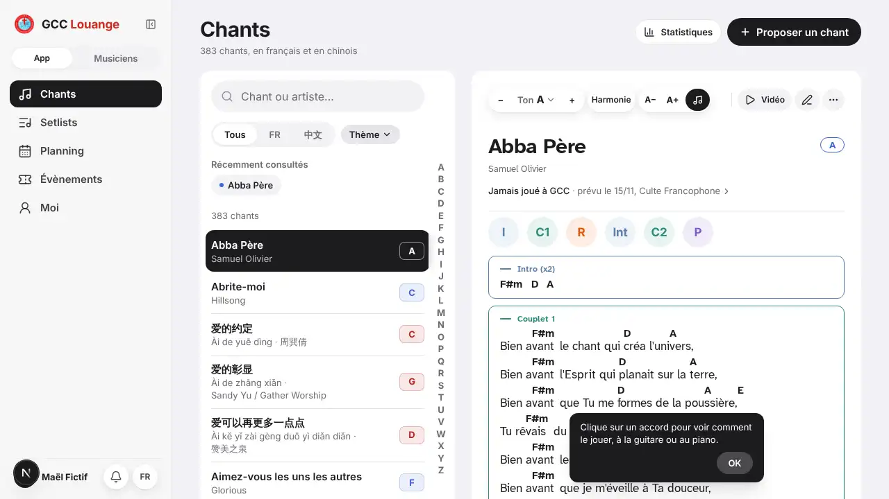 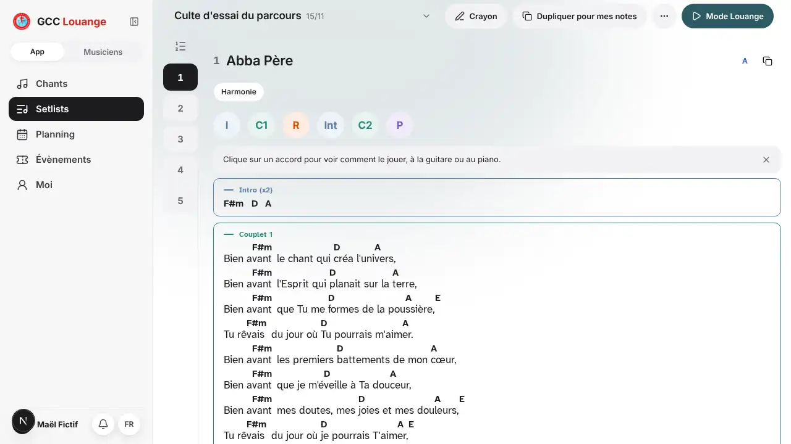

**7. Les réglages d'affichage, trois menus pour la même chose.** Page chant : menu ⋯ (Disposition, Couleur des accords,
Notation, Personnaliser, Signalement). Setlist : bouton « Affichage » (Ordre, Pinyin, Disposition, Couleur, Notation).
Mode louange : partagés entre Je joue (Ordre, Disposition) et Options (Accords, Paroles, Pinyin, Couleur…). Même
contenu, trois noms (⋯, Affichage, Options d'affichage), trois découpages, et trois mentions de portée différentes
(« Retenue sur cet appareil », « Retenue pour ce compte sur cet appareil », « retenu sur cet appareil ») qu'un
musicien ne peut pas démêler. Spec : chaque menu est voulu par son lot ; l'ensemble n'est jamais comparé.
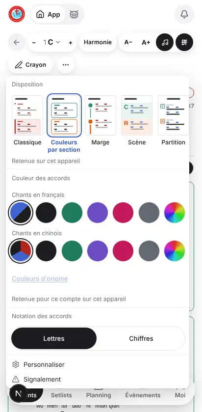 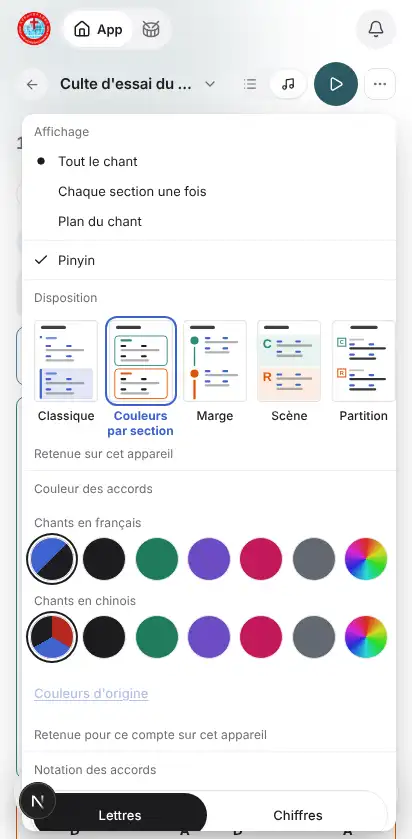

**8. Même commande, autre nom ou autre forme.** Pinyin : bouton « 拼 » sur la page chant, case « ✓ Pinyin » dans
Affichage de la setlist, bouton rond « Pinyin » au mode louange. Accords : icône ♪ seule sur la page chant, mot
« Accords » dans la barre de la setlist au téléphone, bouton « Accords » au mode louange. Aide « touche un accord » :
bulle flottante avec « OK » sur la page chant (posée sur les paroles), bandeau gris avec « × » dans la setlist.
Spec : non comparé. 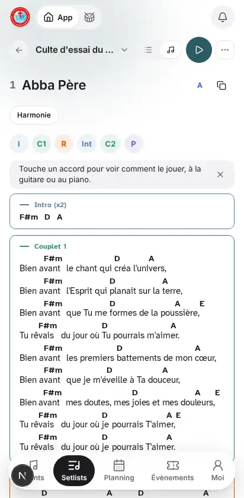

**9. Titre du chant : trois habillages.** Setlist : « 1 Abba Père » ; mode louange barre cachée : « ABBA PÈRE » en
capitales avec une pastille ronde « 1 » ; barre montrée : « Abba Père » centré, en petit. tel, toutes dispositions.
Spec : non voulu explicitement. 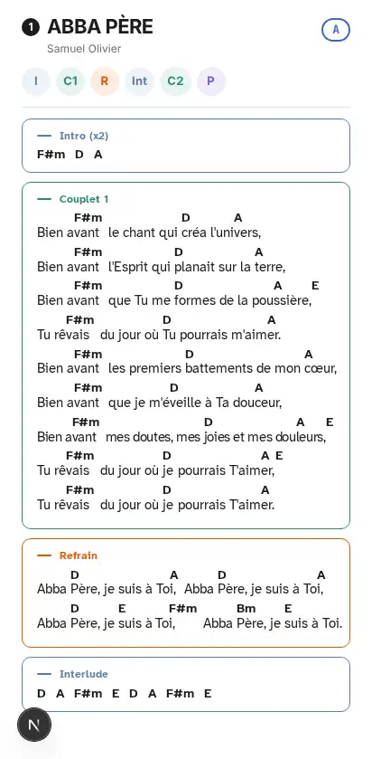

**10. Création d'une setlist à l'ordinateur : la barre « Publier » cache des boutons.** ordi. Sous les chants, deux
boutons (« Ajouter des chants », « Transition ») sont à moitié masqués par la barre collée du bas. Le champ date
n'apparaît qu'une fois la catégorie choisie, alors que l'écran précédent promettait « Choisir le service et la date
soi-même » (`src/components/setlists/editeur/EnTeteEditeur.tsx` l. 240). Spec : non voulu.
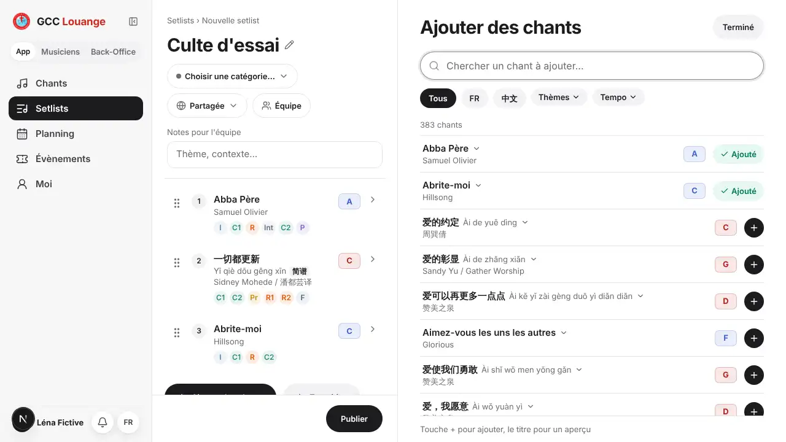

**11. « Mon prochain service » écrit deux fois** dans l'onglet Setlists en grand écran : pastille grise en tête de la
colonne de gauche, titre de la colonne de droite ; la colonne de gauche laisse un grand vide dessous. tabL, ordi, 1440.
Spec : le volet de droite est voulu (`docs/spec-entree-musiciens.md`, PU-2), le doublon non.

**12. Choriste : la setlist montre les accords, le mode louange non.** Vue partitions d'une choriste : accords affichés,
« Accords » allumé ; au mode louange, le même rôle voit les paroles seules. Spec : le rôle ne règle que le mode louange
(`docs/spec-jianpu-integration.md`) ; l'écart se comprend mal.

**12 bis. Lettres / Chiffres s'écrit « A | 1 », collé à « Ton A ».** 1440 (absent à 1 280 px, rangé dans ⋯). Dans la
barre du chant, « Ton A − + » est suivi d'un bouton « A » puis « 1 » : le « A » de la notation se lit comme la tonalité.
Spec : la bascule est voulue dès 640 px (`docs/spec-harmonie-accords.md`, H7-1) ; son libellé d'une lettre non.
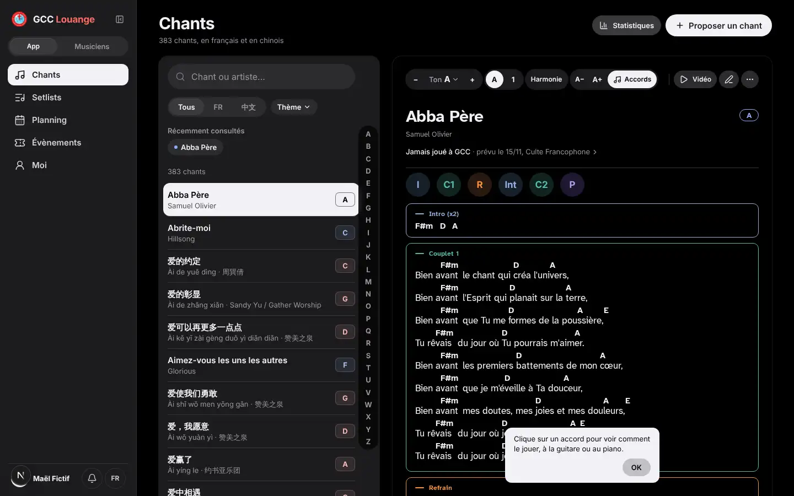

**12 ter. Paroles chinoises : l'alignement sur les accords coupe les mots.** Toutes dispositions, chant chinois en
« Paroles ». Les caractères sont espacés pour tomber sous leur accord, et un mot se casse en deux : « 叫一 ⎵⎵⎵ 切都更新 »
sépare 一切 ; trous dans « 我 ⎵ 为主发光 ». Une choriste lit mal la phrase. Spec : le placement des accords est réglé par
`docs/chants/02-placement-accords.md`, qui ne dit rien de l'écart laissé dans les paroles.
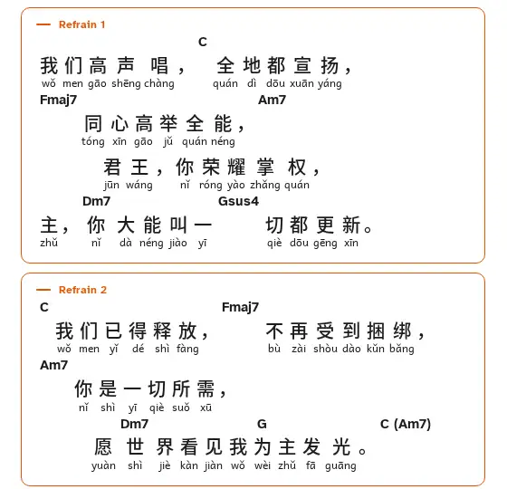

**12 quater. Interface chinoise : noms de sections restés en français.** tabP, tabL, ordi, 1440. Dans « 我的下一次服事 »,
les vignettes d'un chant sans scan disent « Intro (x2) · Couplet 1 · Refrain… », alors que la setlist en chinois écrit
前奏, 主歌 1. Spec : non voulu (les sections ont leurs libellés 中文). 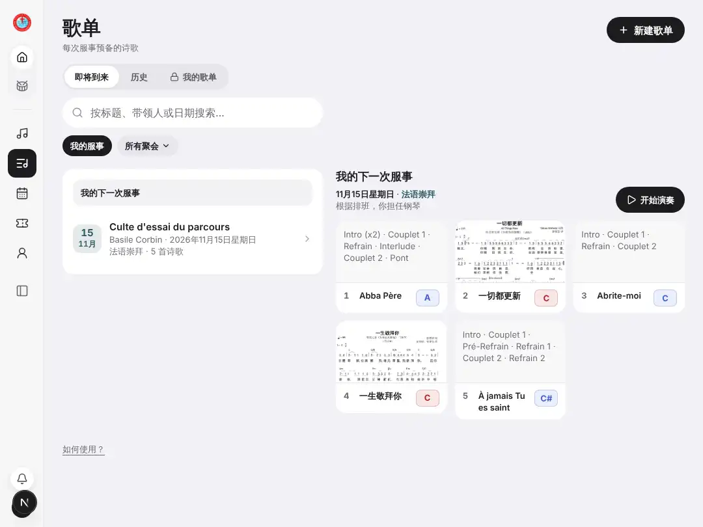

**12 quinquies. Recherche en pinyin trop large.** « yi qie » rend sept chants, dont quatre sans rapport (以前, 一起,
在一起, 差遣我) ; le bon est en tête. Au téléphone, une ligne de résultat coupe « yáng / · 葛兆昕 » avec un « · » en début
de ligne. Spec : non vu. 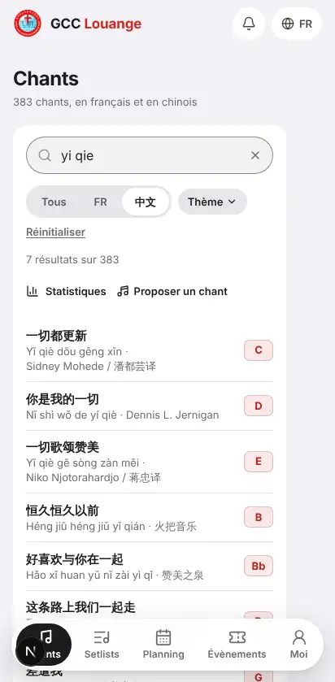

### Gêne faible

**13. Création d'une setlist : changer une tonalité est simple**, à noter comme modèle : toucher le chant, toucher la
tonalité, OK (trois gestes au téléphone, deux à l'ordinateur). 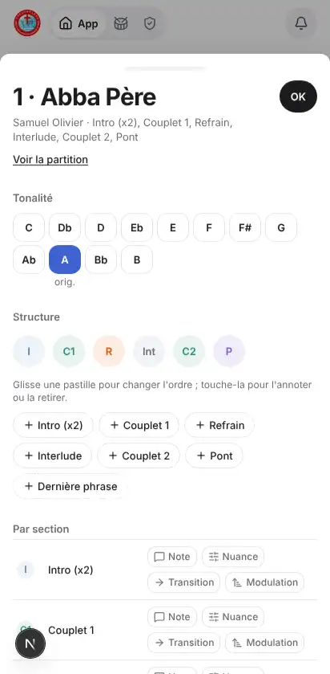
Seul défaut : la tonalité d'origine est marquée « orig. » sous la touche, pas la tonalité recommandée quand elle existe
(à vérifier sur un chant qui en a une).

**14. Création d'une setlist, feuille « Ajouter des chants » au téléphone et en tablette portrait** : les pastilles de
tonalité ne sont pas alignées (à gauche d'« Ajouté », à droite de « + ») ; une setlist vide met « Publier » en noir et
« Ajouter des chants » en gris pâle, l'action à faire d'abord est la moins visible. Spec : non vu.

**15. Mode louange, téléphone et tablette portrait** : grand vide (130 à 170 px) sous la dernière section d'une page,
et au 1 440 px le bas de la 简谱 du chant suivant est coupé net. Spec : la coupe entre blocs est voulue
(`docs/spec-mode-louange-forscore-2.md`, FS-E), le vide et la coupe du scan non.

**16. Le reste du site, en survol.** Harmonie : les pastilles de filtre sont coupées net au bord droit sans signe de
défilement (tel, tabL), et perdent leur fond en sombre en grand écran ; Moi : grand trou sous « Mes services » en grand
écran, et « Réglages » / « Déconnexion » en bas au téléphone mais en haut ailleurs ; Planning en tablette portrait : la
carte « Ton prochain service » étirée avec un vide au milieu. Aucun ne gêne le culte.
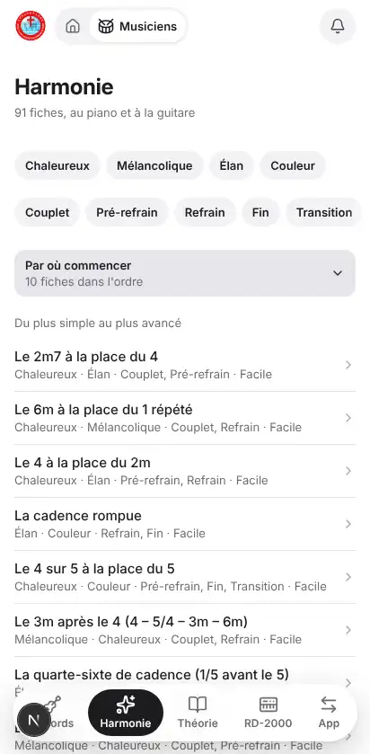

## Gestes des quatre tâches

| Tâche | Gestes | Remarque |
|---|---|---|
| Musicien : ouvrir la setlist de dimanche et jouer | 2 (onglet Setlists, « Jouer » / « 开始演奏 ») | Bon : « Mon prochain service » fait le travail. |
| Responsable : créer une setlist, trois chants, une tonalité | ≈ 12 au téléphone (Nouvelle setlist, Autre setlist, titre, catégorie, date, « Ajouter des chants », 3 × recherche + « + », chant, tonalité, OK, Publier) ; un de moins en grand écran | La date n'apparaît qu'après la catégorie (constat 10). |
| Choriste : chercher un chant chinois et lire le pinyin | 5 (Chants, 中文, recherche, chant, « Paroles ») | Le cinquième n'est indiqué nulle part (constat 4 bis). |
| Passer au chant suivant pendant le culte | 1 balayage ou flèche par page, sans voir le titre suivant | Constat 4. |

## Ce que je n'ai pas pu ouvrir

- **Historique d'une setlist** : absent du menu ⋯ pour un musicien qui ne peut pas la modifier ; pas ouvert avec un
  compte responsable.
- **Édition d'une setlist existante** par un responsable : seule la création a été parcourue.
- **Deux pages côte à côte** au mode louange : non déclenché par le script.
- **« Pour quel service ? »** à la création : le Sheet du planning n'était pas simulé dans ce parcours, la page
  restait sur « Chargement… » ; ce n'est pas un constat.
- Des écrans pris trop tôt (« Mise en page… » après « Jouer » à l'ordinateur, une recherche non appliquée en tablette
  paysage) ont été écartés comme artefacts de capture.
