# Parcours à l'œil du site, 14/11/2026 : les incohérences d'interface

Demande de Timothée (14/11/2026) : « y'a pleins de problèmes d'UI aussi », « t'as regardé les incohérences sur l'UI ?
dans le mode louange et tout ? », « pas que dans le mode louange partout sur le site ». Parcours fait sans toucher au
code ; aucune spec ici, Timothée choisit ensuite.

**Méthode.**
1. Session simulée (`tests/helpers/fakeSession.ts`, `tests/helpers/louange.ts`), une musicienne et un admin fictifs, une setlist de quatre chants (FR `abba-pere`, 中文 en paroles `谢谢你`, scan 简谱 `一生爱你`, FR `a-jamais-tu-es-saint`).
2. `next dev` local (port 3100, back-office ouvert), captures Playwright à `deviceScaleFactor: 1`, hors dépôt : 307 captures.
3. Dispositions : **tel** (412 px), **tabP** (810), **tabL** (1 080), **ordi** (1 280), **1440**. Interface 中文 et thème sombre sur six écrans, à l'ordinateur et au téléphone. Back-office en survol (trois écrans).
4. Premier tri par un agent Sonnet tenant le rôle de `regard`, en deux lots ; 20 captures ouvertes et jugées ici, au moins une par disposition. 18 sont jointes, dans `docs/parcours-oeil-2026-11-14/`.
5. Déjà connu, donc absent : la découpe des 简谱 (deux colonnes, demi-lignes), « Chiffres » sans effet en mode louange, l'accord touché qui tourne la page, le trait en plusieurs tracés (lot CL), le panneau d'un accord qui dépasse du bas à l'ordinateur, la marge « Affichage » qui s'ouvre d'elle-même à la première entrée.

## Les dix choses à changer en premier

1. **Mode louange : chaque feuille se ferme autrement.** Repères et Outils : titre centré, pas de ×. Affichage : titre
   à gauche et ×. Métronome : × en haut **et** chevron ⌄ en bas. Crayon : « Terminé » en haut **et** ✓ en bas.
2. **Outils mélange deux sortes de lignes et nomme deux fois la même chose.** « Annotations » (rond noir) et
   « Crayon » (icône à gauche) ; « Métronome visuel » (rond blanc) et « Métronome ». Un rond plein veut dire
   « allumé », alors que le même « Métronome visuel » est un interrupteur dans la feuille Métronome.
3. **La marge « Affichage » a quatre formes.** Sur la page chant (ordi, tabL, 1440), c'est une feuille à poignée posée
   dans la carte du chant et coupée par le bas de l'écran. Sur la setlist (ordi, 1440), c'est un panneau latéral. Sur
   la setlist en tabP, c'est une feuille flottante centrée. Au mode louange, c'est un panneau ou une feuille du bas.
4. **Au téléphone, ouvrir « Affichage » au mode louange vide la page.** La partition se redécoupe : l'Intro reste
   seule au-dessus d'un blanc de 380 px, et l'on règle l'affichage sans voir le chant.
5. **Accords, Pinyin et Affichage : trois formes pour le même bouton.** Rond à icône seule (page chant au téléphone,
   chant 中文 à l'ordinateur) ; pastille étiquetée (chant FR à l'ordinateur) ; pastille icône au-dessus du mot
   (setlist au téléphone et en tabP). « Accords » se règle en plus par l'interrupteur de la marge, juste à côté.
6. **Au mode louange, la tonalité et le titre changent de forme d'une page à l'autre.** Barre ouverte : carré noir
   « A » et « Abba Père ». Barre cachée : « ❶ ABBA PÈRE » et une pastille ronde bleue « A ». Sur le scan : « 1=E »
   arrondi, posé sur le « 1 = E » imprimé. En bas de page : « Ensuite : 谢谢你 · D ».
7. **Les repères de section changent de forme sur un scan 简谱** : ronds colorés sur une page de paroles, petits carrés
   « I C R » sur une page de scan, plus un rond « R » dans le scan.
8. **L'aide « Touche un accord… » a deux formes.** Sur la page chant, c'est une bulle noire avec « OK », posée sur les
   paroles et laissée devant le menu ⋯. Dans la setlist, c'est un bandeau gris avec ×, au-dessus du chant.
9. **À partir de 768 px, le métronome est introuvable pour un chant sans tempo.** Au téléphone, Outils a une ligne
   « Métronome ». À l'ordinateur et sur tablette, Outils ne l'a pas, et la barre n'affiche ♩ que si le chant a un
   tempo.
10. **La légende « Points : déjà joué · Pleines : sur cette page… » cache le titre de la section du dessous**
    (Couplet 2), au téléphone, en tablette et à l'ordinateur.

## Vérification sur le site réel (agent-desktop, 14/11 après-midi)

Demande de Timothée : vérifier le relevé avec agent-desktop, sur le site en ligne (compte invité, lecture seule :
rien créé, modifié ni annoté ; « Je joue » non touché). Bureau virtuel Xvfb + Chromium. Dispositions vues :
**ordi** (fenêtre de 1 366 px), **1440** (le mode louange passe en plein écran sur un écran de 1 440 px),
**tabP** (fenêtre de 830 px), **tabL** (fenêtre de 1 100 px, page chant seulement). **Le téléphone ne se voit pas par
agent-desktop** (une fenêtre ne descend pas sous 500 px environ) : pour lui, le relevé local du matin fait foi.
Contenus réels vus : une setlist de culte de quatre chants FR à feuille de route annotée, une setlist de Noël (un chant
FR, un scan 简谱). 14 captures, gardées hors dépôt (elles montrent de vrais noms).

### Les dix choses, vues sur le site réel

1. Fermetures des feuilles : **différent** (ordi, 1440, tabP) : Outils y est une bulle sans titre ni × ; Affichage
   a titre et × (panneau à l'ordi, feuille du bas en tabP). Métronome et Crayon non ouverts (lecture seule).
2. Outils, deux sortes de lignes : **oui** (1440, tabP) : cinq ronds noirs ou blancs sans libellé d'état ; « Annotations »
   double le crayon de la barre.
3. Affichage, quatre formes : **différent** : panneau latéral sur la setlist (ordi) **et** sur la page chant à
   1 100 px (pas de feuille à poignée) ; feuille du bas au mode louange en tabP ; panneau au mode louange (1440). Trois
   formes vues, pas quatre.
4. Affichage vide la page (tel) : téléphone non vu ; **oui en tabP** : l'Intro seule au-dessus d'un blanc, et le curseur
   passe de 4 à 8 points.
5. Accords, Pinyin, Affichage : **oui en partie** (tabL) : pastilles étiquetées « Accords », « Affichage » ; Accords se
   règle aussi par l'interrupteur de la marge, juste à côté. Chant 中文 et téléphone non vus.
6. Tonalité et titre au mode louange : **différent** : carré « G » ou « E » à côté du titre, et sur un scan « 1=F »
   dans la barre (plus de pastille posée sur le scan) ; « Ensuite : 恒久恒久以前 · F » en gris : **oui**.
7. Repères sur un scan 简谱 : **différent** : au mode louange (ordi), les pages du scan n'ont **aucun** repère (ni
   carrés ni ronds), alors que la setlist en liste ses cinq sections.
8. Aide « Touche un accord » : **oui en partie** : bandeau gris avec × sur la setlist (ordi) ; la bulle de la page chant
   ne s'est pas montrée (déjà fermée sur ce compte ou cet appareil).
9. Métronome introuvable sans tempo : **oui** (ordi, 1440, tabP) : pas de ♩ dans la barre pour un chant sans tempo, pas
   de ligne « Métronome » dans Outils ; avec tempo, « ♩ 94 » ou « ♩ 132 » est bien dans la barre.
10. Légende des points sur un titre de section : **non vu** (aucune page des deux setlists ne l'a montrée).

### Gêne forte (A à G), vue sur le site réel

- A : différent (voir 1). B : oui. C : téléphone non vu, oui en tabP. D : différent (voir 6). E : différent (voir 7).
  F : non vu. G : oui.

### Ce que seul le site réel montre

**Gêne forte**
- **R1. La feuille de route s'éclate quand une section porte une note.** ordi, 1440. Sur un chant dont la feuille de
  route a une consigne longue (« boom avec la batterie puis elle revient plus fort… »), la note se loge dans la rangée
  des ronds : un rond « R » flotte seul au milieu, les suivants partent au bord droit, et sur la setlist la rangée
  passe sur deux lignes avec la note en dessous. On ne lit plus l'ordre des sections d'un coup d'œil, c'est-à-dire ce
  qui sert pendant le culte. Correction : la note sous son rond, en petit, ou en bulle ; la rangée garde le pas des
  ronds. **S.**
- **R2. Repères absents sur un scan 简谱 au mode louange** (constat 7 ci-dessus) : pour un chant chinois, plus de repère
  du tout. **S.** À revoir après CL-1 (lot CL en cours : la page du scan redevient entière et ses Repères sont
  repris, `docs/spec-corrections-louange.md`) avant d'en faire une correction.

**Gêne moyenne**
- **R3. Date du service fausse d'un jour sur la page chant.** tabL. La page d'un chant dit « prévu le 24/12, Noël »
  alors que la setlist est datée du vendredi 25 décembre. Probable décalage de fuseau (date lue en UTC). **S.**
- **R4. Paroles décalées d'un espace sous un accord en début de ligne.** Toutes dispositions (page chant, setlist, mode
  louange). Sur un chant réel, chaque vers qui commence sous un accord est poussé d'un caractère à droite (« E / ␣Dans la
  ville de David »), les autres non : la marge gauche des paroles est en dents de scie. À trancher : contenu du `.cho`
  ou rendu. **S.**
- **R5. La barre d'une setlist change selon la setlist.** ordi : « Crayon, Dupliquer pour mes notes, Affichage, ⋯ » sur
  l'une, « Crayon, Modifier, PDF, Affichage, ⋯ » sur l'autre (droits du compte), sans repère pour l'œil. Complète L.
- **R6. Couleur du bouton « Mode Louange »** : sarcelle sur une setlist de culte, vert sur une setlist de Noël. Voulu
  (couleur du service) ou non : à trancher. **S.**

**Gêne faible**
- Rail de la tablette paysage : **différent** à 1 100 px (barre latérale complète, avec libellés).
- Retour de la page chant : « ← Retour » avec le mot à 1 100 px (pas la flèche seule).
- « Classique » et « Couleurs par section » se touchent sous les vignettes de la marge, et « Couleurs par section » tient
  sur trois lignes : **oui** (ordi, tabL).

### Les dix revues après le site réel

1. Feuille de route éclatée par une note (R1). 2. Métronome introuvable sans tempo (9, G). 3. Affichage vide la page,
au téléphone et en tablette portrait (4, C). 4. Outils, deux sortes de lignes (2, B). 5. Repères absents sur un scan
(7, R2). 6. Fermetures des feuilles (1, A). 7. Affichage, trois formes (3, H). 8. Tonalité et titre (6, D). 9. Date du
service fausse d'un jour (R3). 10. Accords, Pinyin, Affichage (5, I).
Sortent de la liste : l'aide « Touche un accord » (8, pas revue en bulle) et la légende des points (10, pas vue).

## Constats

Dispositions : tel, tabP, tabL, ordi, 1440. Taille : S (un composant, quelques lignes), M (plusieurs écrans ou un
comportement), L (refonte d'un ensemble). « 13/11 » : déjà relevé dans `docs/parcours-oeil-2026-11-13.md`.

### Gêne forte (pendant le culte)

**A. Fermetures des feuilles du mode louange.** tel surtout, tabP. Repères et Outils n'ont ni titre à gauche ni ×,
alors qu'Affichage et la fenêtre d'harmonie ont les deux. Le Métronome a un × en haut et un chevron en bas, avec des
marges de 28 px au lieu de 16. En Crayon, on peut sortir par « Terminé » en haut ou par ✓ en bas. Le menu Setlist a
des onglets au lieu d'un titre.
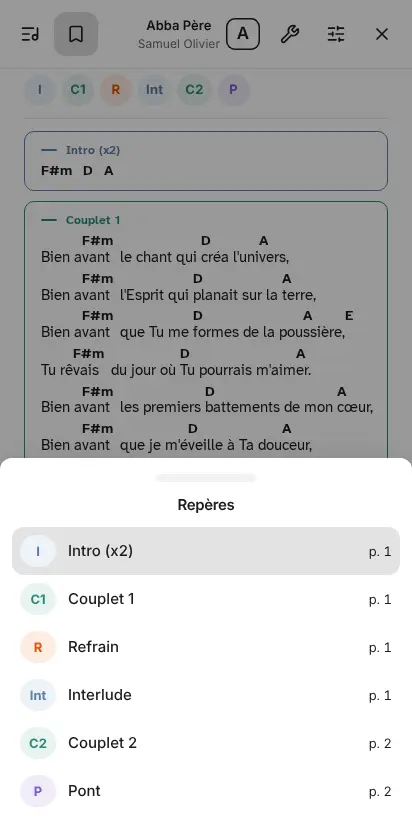 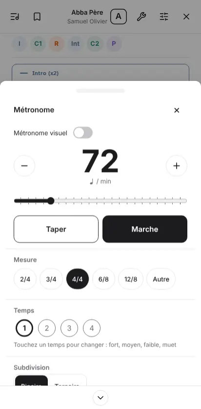
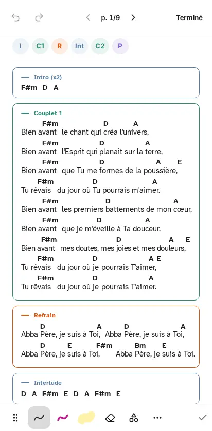
Correction : un seul en-tête pour toutes les feuilles du mode louange (titre à gauche, × à droite, pas de seconde
sortie en bas). **M.** 13/11 : non.

**B. Outils : deux styles de ligne, doublons, état peu lisible.** tel, tabP, tabL, ordi, 1440. Cinq lignes ont un
rond à droite, noir quand c'est allumé et blanc quand c'est éteint, sans libellé d'état. Au téléphone suivent
« Crayon » et « Métronome », en icône à gauche : le premier fait doublon avec « Annotations », le second avec
« Métronome visuel ». Ce « Métronome visuel » est un rond ici et un interrupteur dans la feuille Métronome.
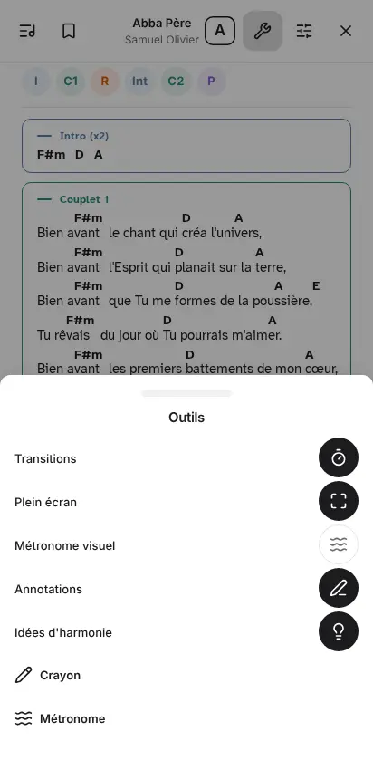 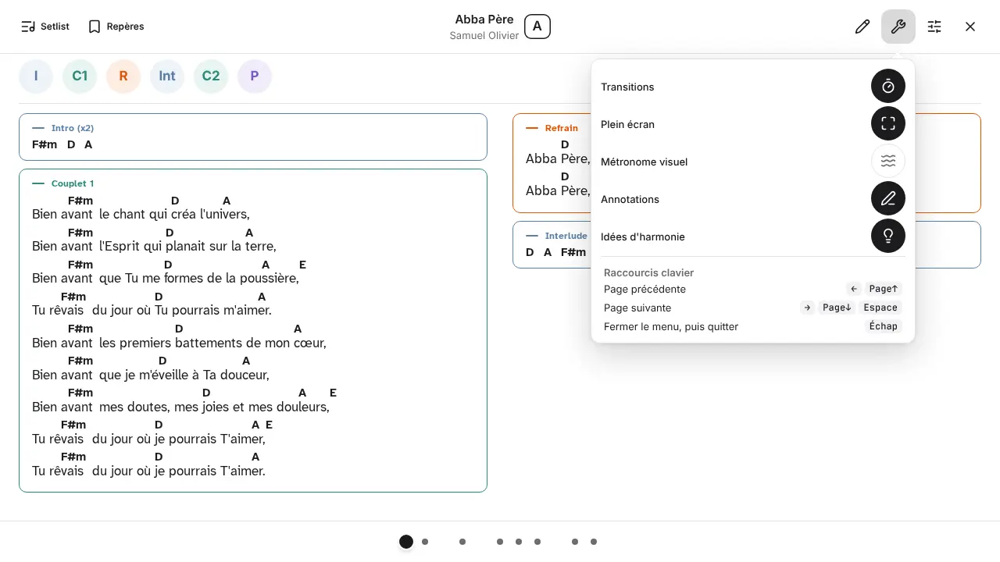
Correction : les réglages en interrupteurs (comme dans Affichage), les actions en lignes à icône, un seul nom par
fonction. **S.** 13/11 : non.

**C. Au téléphone, la marge Affichage vide la page du mode louange.** tel (tabP : même effet, relevé au tri). Feuille
ouverte, la partition est redécoupée pour la place restante. Il ne reste que l'Intro, sous 380 px de blanc, et le
curseur de pages compte 18 points. 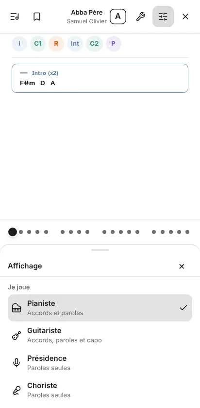
Correction : garder la page telle quelle sous la feuille (la feuille la recouvre, comme le menu Repères) au lieu de la
redécouper. **M.** 13/11 : non (nouveau depuis RU-5).

**D. Tonalité et titre au mode louange : quatre habillages.** Toutes dispositions. Avec la barre : carré noir « A » à
côté de « Abba Père ». Sans la barre : « ❶ ABBA PÈRE » en capitales et une pastille ronde à bord bleu « A », collée au
coin haut droit (4 px du bord). Sur le scan : pastille « 1=E » posée sur le « 1 = E » imprimé, ce qui rend les deux
illisibles (ordi, tabL, 1440 ; pas en tabP). Dans la pastille « Ensuite » : « · D » en gris.
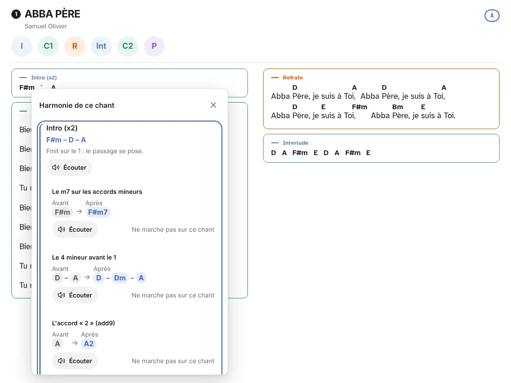 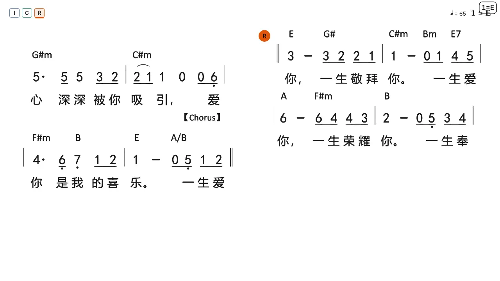
Correction : le carré de la barre partout, à 24 px des bords comme le reste, et pas de pastille sur un scan qui imprime
déjà sa tonalité. **S.** 13/11 : oui pour le titre (constat 9), non pour la tonalité.

**E. Repères ronds sur les paroles, carrés sur le scan.** ordi, tabL, 1440, tel. En haut d'une page de scan, les
repères deviennent de petits carrés « I C R » de 20 px, alors qu'ailleurs ce sont des ronds de 44 px. Un rond « R »
s'ajoute dans la marge du scan. 
Correction : les mêmes ronds en tête de chaque page. **S.** 13/11 : non. (Couleurs gelées, forme seulement.)

**F. Légende des points sur le titre d'une section.** tel, tabP, tabL, ordi (pas 1440, où tout tient sur une page).
« Points : déjà joué · Pleines : sur cette page, avec leur nuance » recouvre « Couplet 2 » et sa première ligne.
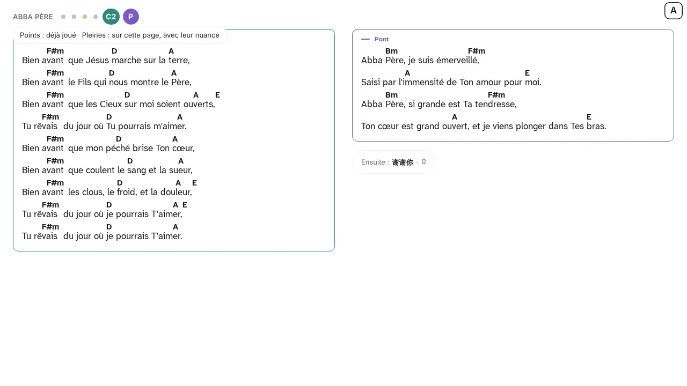
Correction : la montrer dans la bande des repères, ou ne la montrer qu'une fois. **S.** 13/11 : non.

**G. Métronome introuvable à partir de 768 px pour un chant sans tempo.** tabP, tabL, ordi, 1440. La barre n'affiche ♩
que si le chant a un tempo (`BarreHaut.tsx`, l. 109). Outils n'a pas la ligne « Métronome » du téléphone. Il faut
allumer « Métronome visuel » pour voir le bouton apparaître. Comparer `louange-outils-tel` et `louange-outils-ordi`.
Correction : la ligne « Métronome » d'Outils à toutes les tailles. **S.** 13/11 : non.

### Gêne moyenne (préparer, retrouver, régler)

**H. La marge « Affichage » : quatre formes, et coupée par le bas.** Page chant (ordi, tabL, 1440) : feuille à poignée
dans la carte du chant, qui recouvre le Couplet 1 et se coupe au bas de l'écran (« Ordre des sections » à moitié
visible, sans signe de défilement). Setlist (ordi, 1440) : panneau latéral pleine hauteur, sans poignée. Setlist (tabP) :
feuille flottante centrée, 560 px de large. Mode louange : panneau ou feuille du bas.
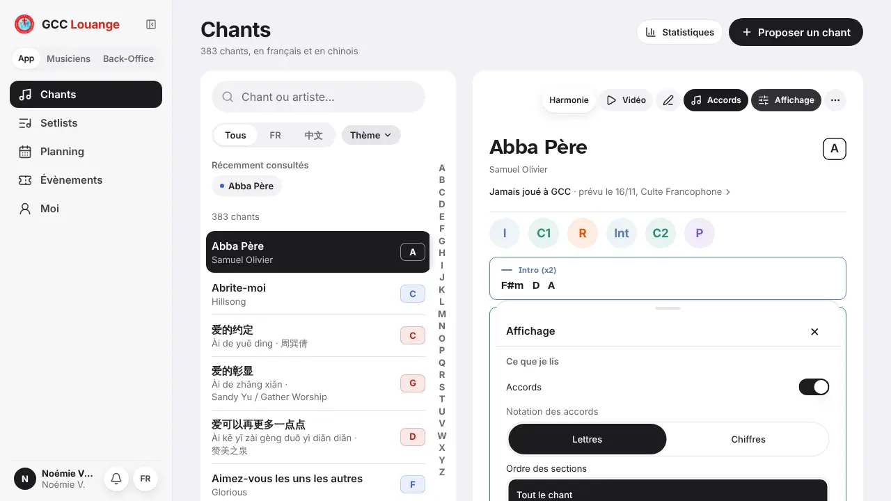 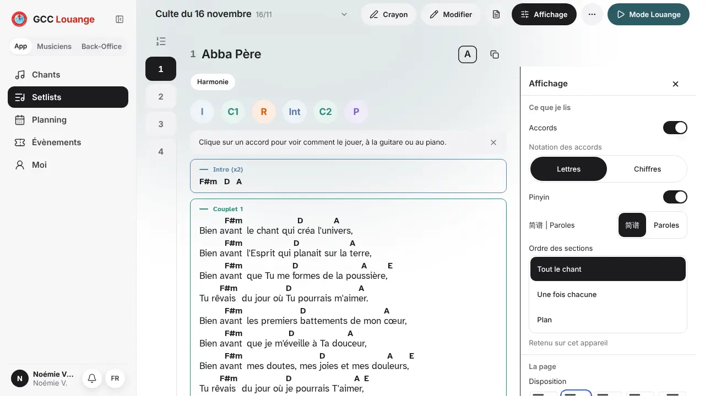
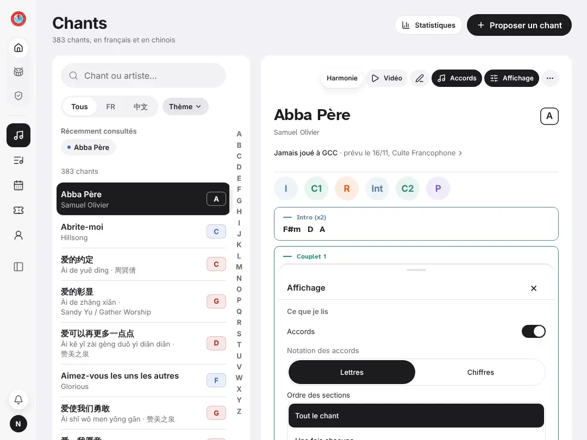 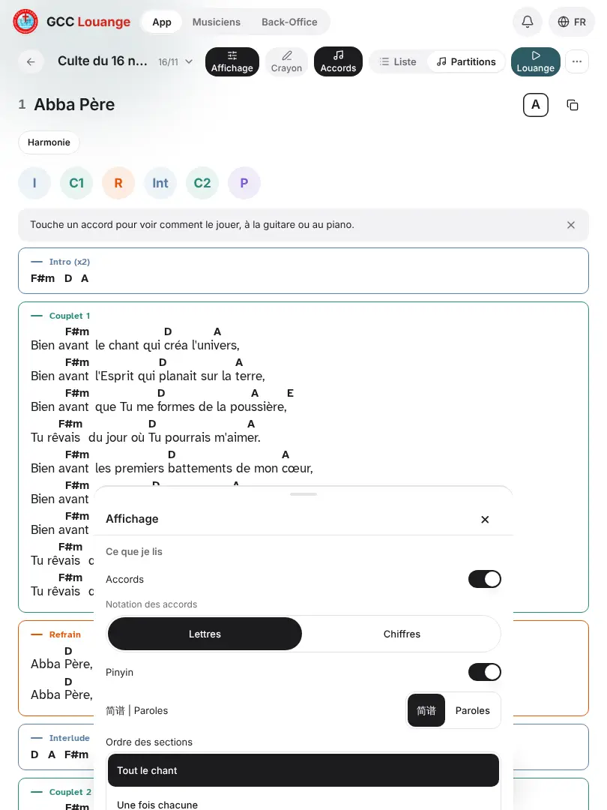
Correction : le panneau latéral de la setlist pour la page chant dès qu'il y a la place, la feuille du bas pleine
largeur en dessous. **M.** 13/11 : constat 7 en partie (un seul contenu depuis RU, mais pas une seule forme).

**I. Accords, Pinyin, Affichage : trois formes du même bouton, plus un doublon.** Page chant, tel : ronds à icône seule ;
Accords et Affichage ouverts y sont deux ronds noirs identiques. Chant 中文, ordi : ♫ et 拼 en ronds, alors que le
chant FR, au même écran, dit « Accords » en toutes lettres. Setlist, tel et tabP : pastilles icône au-dessus du mot,
à 11 px. Le même réglage « Accords » est aussi l'interrupteur en tête de la marge.
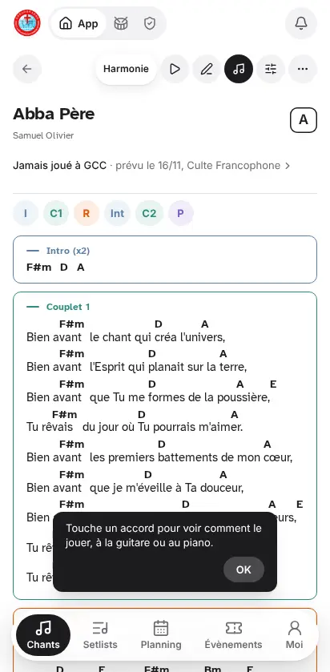 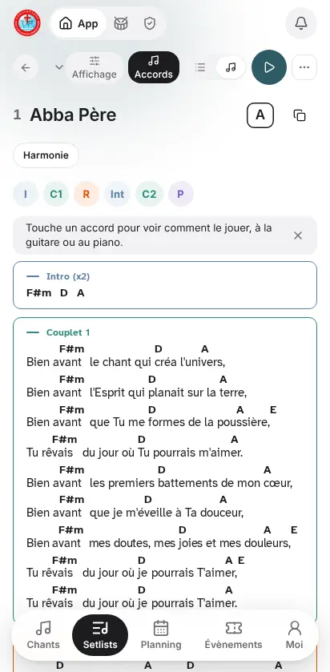
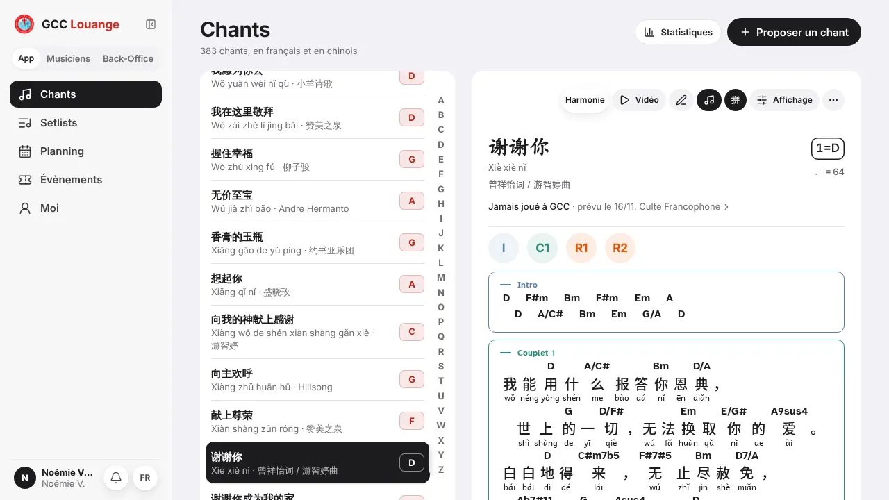
Correction : une seule forme par disposition, quel que soit l'écran et la langue du chant. **S.** 13/11 : oui
(constat 8), toujours là.

**J. L'aide « Touche un accord » : bulle noire « OK » ici, bandeau gris × là.** Page chant (toutes dispositions) : bulle
posée sur les paroles, qui reste devant le menu ⋯ ouvert. Setlist : bandeau au-dessus du chant.
 
Correction : le bandeau de la setlist sur la page chant. **S.** 13/11 : oui (constat 8), toujours là.

**K. Le bouton du mode louange change de nom et de forme.** « Mode Louange » (pastille sarcelle, ordi et 1440),
« Louange » (icône au-dessus du mot, tabP), rond ▶ sans mot (tel). Comparer `setlist-marge-ordi`,
`setlist-marge-tabP`, `setlist-partitions-tel`. Correction : le même libellé partout où la place le permet. **S.**
13/11 : non.

**L. Setlist : barre du haut qui change de contenu et titre tronqué.** tabP : « Culte du 16 n… », car la barre porte
Affichage, Crayon, Accords, Liste/Partitions, Louange et ⋯. Au téléphone, la bascule Liste/Partitions est un segment de
20 px, et « Affichage » touche le bord haut. À l'ordinateur, Accords passe dans le menu ⋯, Modifier et PDF dans la barre.
Au téléphone, le ⋯ commence par « Crayon » sans icône. 

Correction : une barre qui garde les mêmes boutons dans le même ordre et replie les derniers dans ⋯. **M.** 13/11 : non.

**M. Setlist à 1 440 px, marge ouverte : deux colonnes trop étroites, paroles coupées.** 1440. La setlist garde deux
colonnes de 355 px à côté du panneau de 320 px. Les vers passent à la ligne (« Bien avant que Tu me formes / de la
poussière »), avec leurs accords. En tabL, la même marge donne une colonne confortable.
Une seconde finition sur la même capture : « Classique » et « Couleurs par section » se touchent sous les vignettes.
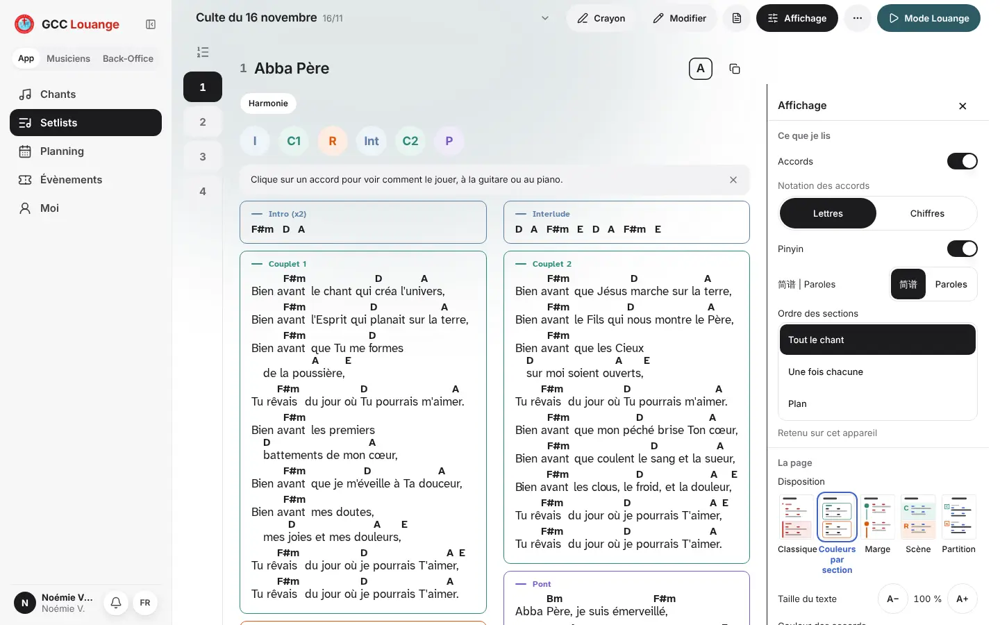
Correction : une colonne quand la marge est ouverte, comme en tabL. **S.** 13/11 : non.

**N. Fenêtre des idées d'harmonie coupée en bas.** tabL, 1440, tabP. Accrochée au nom de section touché (voulu), elle
déborde du bas en tabL : la liste s'arrête au milieu d'une idée, sans signe de défilement.

Correction : la borner à la hauteur restante, comme le menu Setlist. **S.** 13/11 : non.

**O. États actifs dépareillés.** Toutes dispositions. Pastille blanche sur gris : Tous / FR / 中文, À venir / Archives,
Équipes / Musiciens. Fond noir : Lettres / Chiffres, Tout le chant, Guitare / Piano. Puces noires : Planning. Coche sur
gris : rôle « Pianiste », « Mes setlists ». Comparer `chant-marge-ordi` (Lettres en noir) et `chant-zh-ordi`
(Tous / FR / 中文 en blanc). Correction : une règle (segment de vue = blanc, réglage = noir), écrite une fois. **M.**
13/11 : non.

**P. Équipes : colonnes qui défilent sur le côté, ordre qui change.** tabP, tabL, 1440. Les cartes sont rangées en
colonnes défilantes : 2 colonnes et un fondu à droite en tabP, une 4ᵉ coupée (« Louan… ») en tabL, une 5ᵉ à 1 440 px.
L'ordre des équipes change selon la taille et entre l'app et le back-office. Seul le fondu signale le défilement.
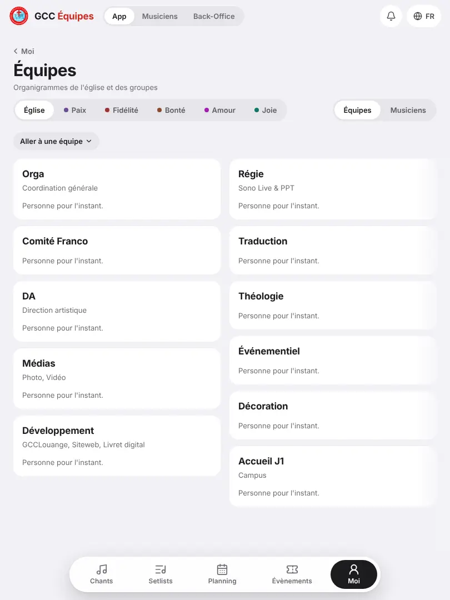
Correction : une grille qui passe à la ligne, dans un ordre fixe. **M.** 13/11 : non.

### Gêne faible

- **Retours** : « ‹ Setlists », « ‹ Moi » en texte (création, équipes, guide) ; flèche ronde ← sans mot (page chant et
  setlist, tel) ; rien en tabL et à l'ordinateur sur une setlist. **S.** 13/11 : non.
- **Rail de la tablette paysage** : maison, tambour, bouclier sans libellé pour App / Musiciens / Back-Office. Deux
  éléments y paraissent actifs (maison cerclée, onglet noir). La langue et le thème manquent, alors qu'ils sont là
  aux autres tailles. Voir `chant-marge-tabL`. **S.** 13/11 : non.
- **Évènements** (tabL, 1440) : « Aucun évènement à venir… » écrit deux fois, dans une carte puis en texte nu. **S.**
- **Moi** (tabP, 1440) : grand trou sous « Mes services » ; « Réglages » change de place selon la taille. **S.**
  13/11 : oui (constat 16), toujours là.
- **Setlists à 1 440 px** : « Ouvrir » et « Mode Louange » collés au bord droit, loin de la carte de 414 px. **S.**
- **Interface 中文** : le filtre de la liste reste « FR / 中文 » (« 全部 FR 中文 »), alors que la setlist écrit 法语.
  **S.** 13/11 : non.
- **Sombre** : « Affichage » gris clair sur pastille grise (setlist, tel), onglets Musiciens / Back-Office gris sur
  gris, nom du service vert d'eau sur gris foncé (accueil). **S.** 13/11 : non.
- **Harmonie** (tabL) : les puces de filtre restent coupées au bord droit (« Élan »). **S.** 13/11 : oui (constat 16),
  toujours là.
- **Paroles chinoises** : trous entre caractères (« 世 上 的一 切 , 无法换取 »), page chant et mode louange.
   **M.** 13/11 : oui (constat 12 ter), toujours là.
- **Liste des chants** (tabP) : l'index A–Z, la carte et « Proposer un chant » ont trois bords droits différents. **S.**

## État des constats du 13/11

| 13/11 | État le 14/11 |
|---|---|
| 1. Options trop long, coupé | **Corrigé** : le menu n'existe plus (marge Affichage, RU-5). Elle a son propre défaut au téléphone (C). |
| 2. Je joue, Disposition coupée | **Corrigé** : « Je joue » est le premier groupe de la marge, rien n'y est coupé. |
| 3. Cadres vides du choriste | Corrigé le 13/11 ; non revu (pas de rôle Choriste dans ce parcours). |
| 4. Chant suivant inconnu | **Corrigé** : pastille « Ensuite : 谢谢你 · D » en bas de la dernière page. Les points restent sans numéro (tabL). |
| 4 bis. Choriste, scan sans pinyin | Non revu. |
| 5. Tonalité tronquée au téléphone | **Corrigé** : la barre n'a plus « Ton », la tonalité est le carré à droite du titre. |
| 6. Tonalité, trois formes | **En partie** : même carré sur page chant, setlist et barre du mode louange ; restent les formes de D. |
| 7. Trois menus de réglages | **En partie** : un seul contenu (marge Affichage) ; quatre formes (H). |
| 8. Même commande, autre forme | **Toujours là** (I, J). |
| 9. Titre, trois habillages | **Toujours là** (D). |
| 10. Création, « Publier » cache des boutons | Non revu (l'éditeur n'a pas été atteint, voir plus bas). |
| 11. « Mon prochain service » deux fois | Non revu. |
| 12. Choriste, accords en setlist | Non revu. |
| 12 bis. « A \| 1 » collé à « Ton A » | **Corrigé** : « Lettres / Chiffres » est dans la marge. |
| 12 ter. Paroles chinoises coupées | **Toujours là** (faible). |
| 12 quater. Sections en français en 中文 | En partie : la setlist en 中文 écrit 前奏, 主歌 1 ; vignettes de « 我的下一次服事 » non revues. |
| 12 quinquies. Recherche pinyin trop large | Non revu. |
| 13, 14. Création, tonalité et feuille « Ajouter » | Non revu. |
| 15. Vide sous la dernière section | Non revu en soi. |
| 16. Harmonie, Moi, Planning | Harmonie et Moi **toujours là** ; Planning tabP non revu. |

## Ce qui n'a pas pu être ouvert

- **Panneau d'un accord au mode louange** : le clic du script ne l'a ouvert à aucune taille (soulignement seul à
  l'ordinateur). Le panneau de la page chant, lui, a été vu.
- **Feuille Métronome à partir de 768 px** : pas de bouton ♩ pour un chant sans tempo (constat G). Vue au téléphone
  seulement.
- **Vue Partitions d'une setlist** en tabL, ordi et 1440 : elle n'existe pas en deux volets (le sommaire en tient lieu).
  Les captures montrent la vue unique.
- **Éditeur de setlist** : « Pour quel service ? » s'affiche (planning simulé vide), mais l'éditeur n'a pas été ouvert.
- **Annonces** : l'adresse mène à la page Évènements.
- **Accueil** : l'adresse `/` mène au Planning.
- **Interface 中文 et sombre sur tablette** : ces deux variantes n'ont été prises qu'à l'ordinateur et au téléphone, comme prévu.
- **Back-office** : trois écrans seulement (accueil, planning, équipes), à l'ordinateur et au téléphone.
